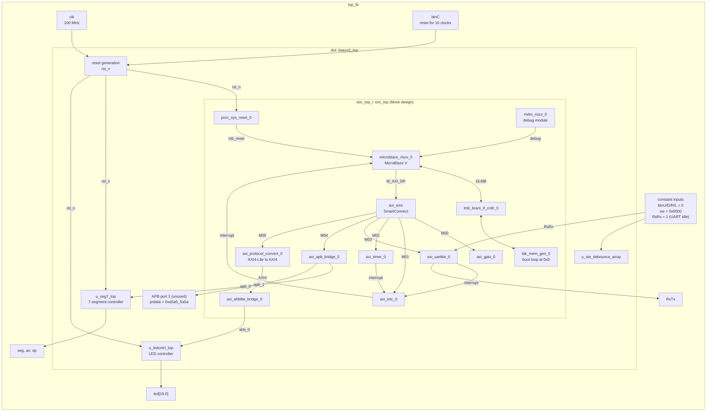

# Testbench `top_tb`

`top_tb` ([top_tb.sv](top_tb.sv)) simulates the complete SoC (`basys3_top`). It generates the clock and the reset, ties all other inputs to constant values and lets the MicroBlaze V core run the boot loop from the block RAM.

## Block diagram

The clock (`clk`) goes to every block; its arrows are left out for readability.

## Stimulus

| Time | Action |
|---|---|
| 0 | `btnC = 1`: reset active |
| 10 clocks | `btnC = 0`: reset released |
| + 20 µs | `$finish` |

## What to check in the waveform

Signals in scope `top_tb/dut/soc_top_i`:

| Signal | Expected |
|---|---|
| `proc_sys_reset_0_mb_reset` | falls a few clocks after `btnC` is released |
| `microblaze_riscv_0_DLMB_ADDRSTROBE` | pulses repeatedly: the core fetches instructions |
| `microblaze_riscv_0_DLMB_ABUS` | `00000000` |
| `microblaze_riscv_0_DLMB_READDBUS` | `0000006F` (`jal x0, 0`, a jump to itself) |
